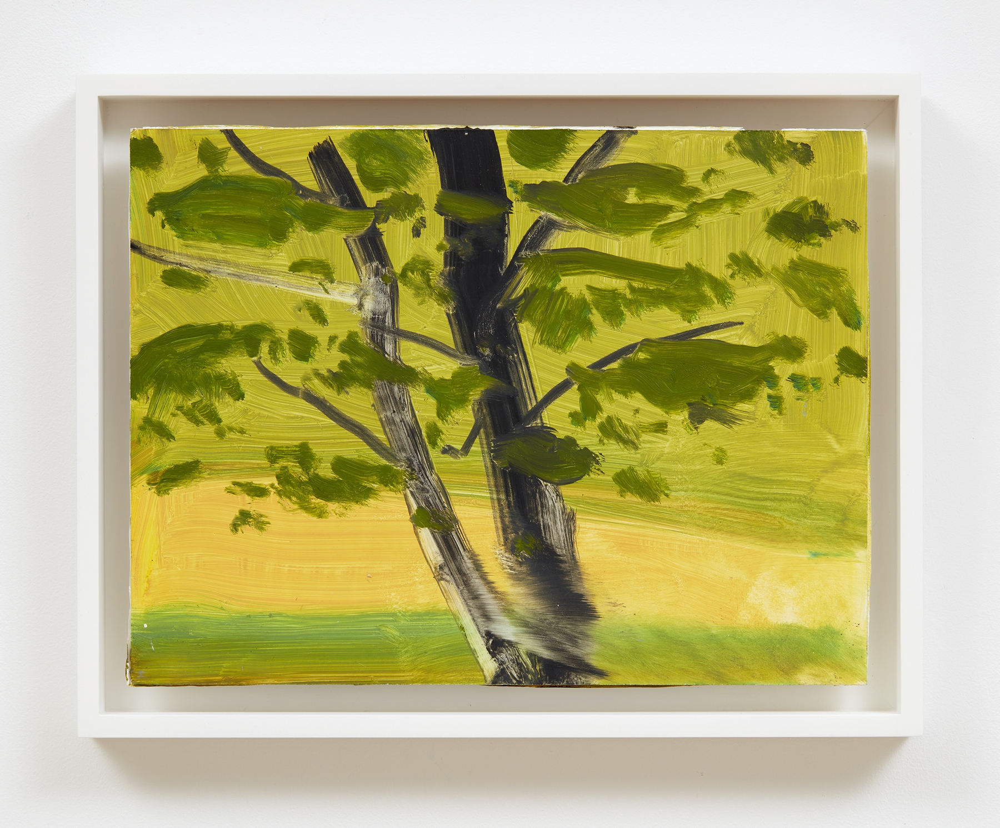
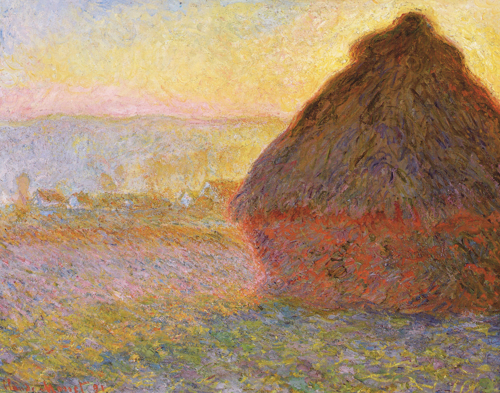

related monthly nugget moc and ref material:

[[pub-nug-moc-261111]]

### Landscape Motif and Scale of Brush Mark

Landscapes are notoriously one of the most difficult motifs in representational painting.

> "I struggle with the landscapes.  Perhaps an issue of bringing what is a larger work down to the size of my page while keeping the feel of the brush strokes." - Student Email

**I suggest a couple simple tactics:** 

> 1. Use a larger surface to paint on so that the feel of the brush strokes don't get squished.
> 2. Make a small value sketch first (If  you want more details on this I can elaborate).

Two examples from art history of landscape paintings with different size brush marks: 

 