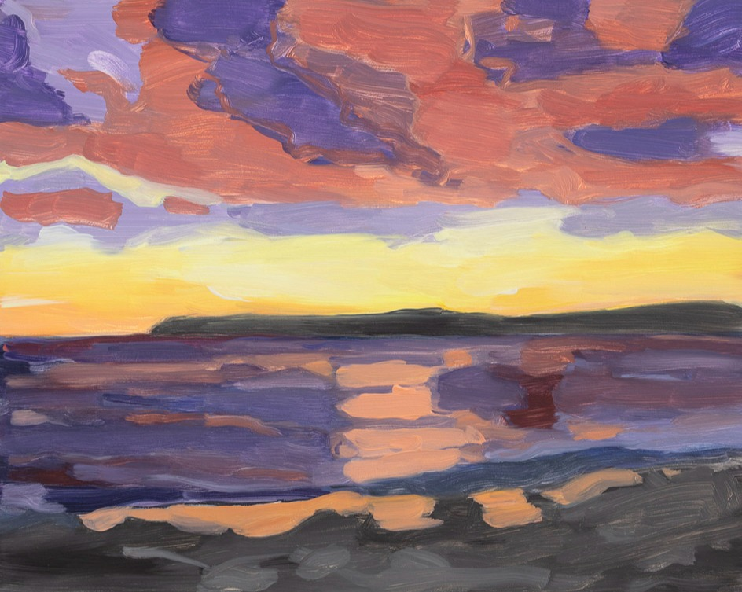
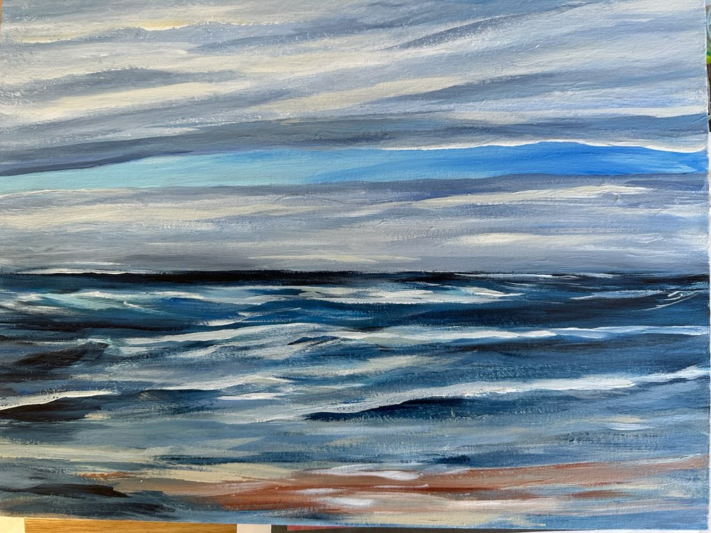

related monthly nugget moc and ref material:

[[pub-nug-moc-261111]]

---

### Details: Loose and Bold Paint Style

> "I like the **bold patches of color** which depict the sky , the land.. **unambiguously but without detail..."**  - lStudent Email 

---

Comparison of student work on the right with art historical example on the left.

 

###### Technique suggestion to achieve your goal: 
- Use one brush a little larger than you would like for an entire painting.
- Focus on getting a buttery consitency to your paint. 
   - Don't let it be scratchy / Mix enough paint

---

These student comments are classic in the trajectory of learning to make art and paintings. **Painting is a language.** It has its own rules. When you are speaking about details you are also speaking about a method of approaching what a detail is. 

In painting, details are spots of color, relations of values, straight things, round things. This is all it means to look at a thing abstractly: to see nouns such as hair and eyes as formal stuff of a visual lexicon. [[Seeing abstractly]] is to get in this mind space where it is no longer an ocean and a rock but rather a green and a brown.

---
What is a [[detail]]? Is it just something small? Or is it a defining characteristic? Or why do you think you go for the details first?