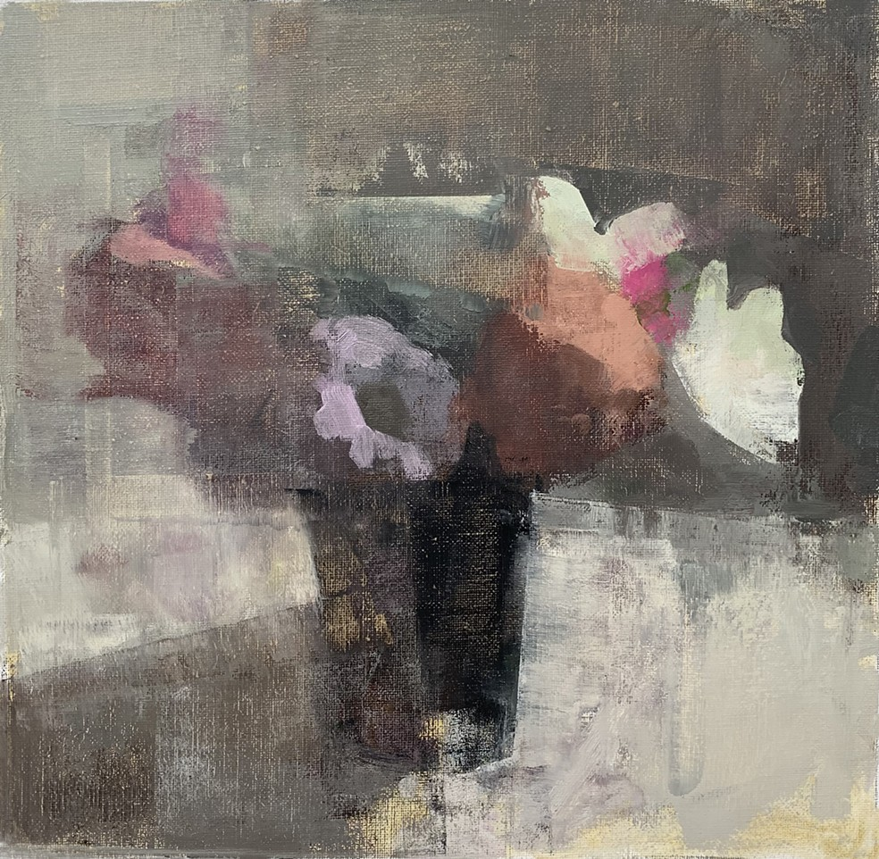

[[pub-nug-moc-261111]]

### Painting Prompt
(Single Still Life Painting)

---

Here is a still-life and question for inspiration -If you have time please write a reply before Saturday:

> 1. What is this artists  definition of a finished painting?
> 2. Would this painting *mean* the same if it was made with an entirely additive process?
> 3. If you like this painting, When do you like it?
> 4. If you don't like it, When do you not like it?

*Don't be shy with your words. Let it all out. I am genuinely intesested to read your thoughts.*

---

- Summary of workshop 0001 member responses: [[ws-xc0001-gr-rs-prmpt1-2611]]

---

