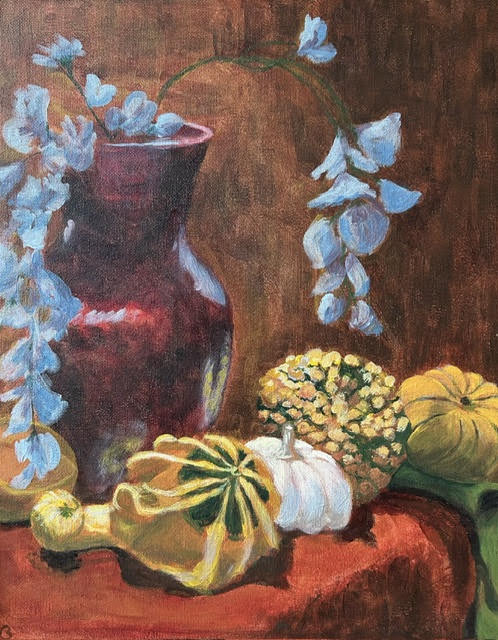

related monthly nugget moc and ref material:

[[pub-nug-moc-261111]]

### Satisfaction and Ego in Painting Process

This still-life makes me think of satisfaction. Part of the skill learning process is satisfaction. Sometimes it appears as ego and other times enjoying accomplishment. 

> I feel it when I look at the traces of you carving out the burgundy vase. The way a brush can carve out the edge of something. There is a nice quality to finding the dimension and curve of the vessel that also has a satisfaction to it.  As if acknowledging that yes paint can be maneuvered in this way. A kind of working with the paint as opposed to against it.

I would like to carry on with this idea for a moment because I think it is fascinating with respect to achievement and confidence in various endeavors.

It seems with creativity, that we have to start with something. There has to be some injection of what we know and are good at and then we can kind of let the unknown and less-practiced moments come in at the edges of that boundary. At least this is one model. 

This history of art is wrapped up in throwing out rationality after WW1 and accepting  [[Freudian]] influenced ideas that humans have feelings and emotions that are unruly. 

Each student of art can decide for themselves how much of the unknown or lost feeling to accept into their process and how that engages with satisfaction and intention. Each student/artist can create a metaphor that makes sense for themselves. Intention-satisfaction as a cell surrounded by the unknown, or is it more like an archipelago, or is it kind of a completely random sheet of porosity.

How do you relate to this idea? Can you imagine a metaphor for your process like this?