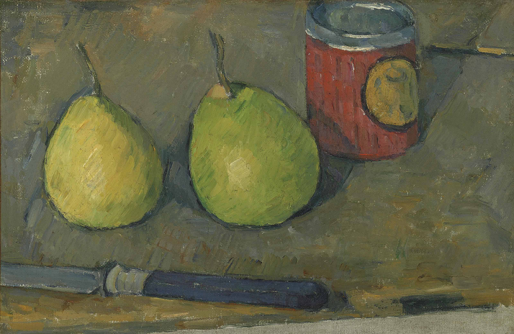
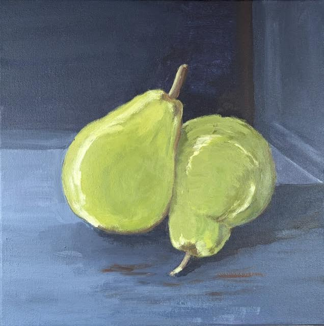

 
 [se-cathy-santiago]
 [pub-nug-moc-261111](app://obsidian.md/pub-nug-moc-261111)
 

### Anthropomorphizing Objects and Narrative in Compositions

---

Your pears can be seen as [[anthropomorphized]] and snuggling. In the [[Flower Workshop]] I talked about how once there are 2 objects in a composition all of a sudden the composition can take on a [[narrative]] in a different way than when there is just a single object.

---
- 
  