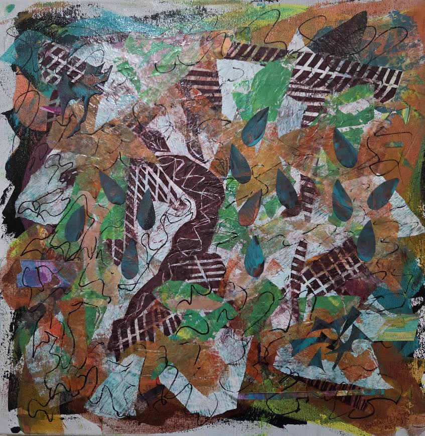
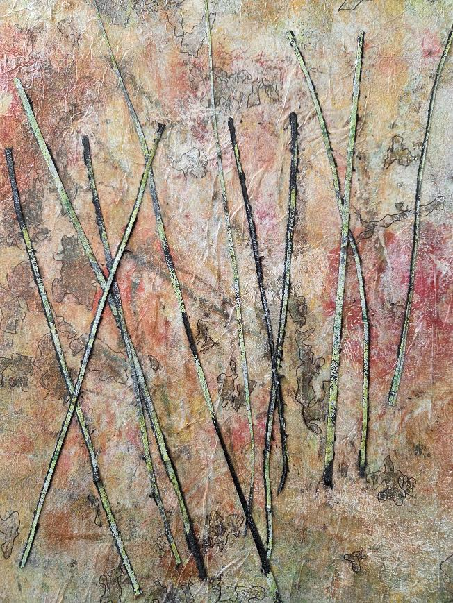

[[se-cowr-261109]]
[[pub-nug-moc-261111]]

### Realism and Obfuscation

> **"Does [[collage]] mean something is always hiding?" sapa**
> 
> **"Maybe meaning in [[abstraction]] is always hiding. Wouldn't the work be realism if obvious?" cowr**

- What I mean here is that the simple mechanics of collage means that the history of the process is literally covered up. 

- This act of covering up in collage is specific to its medium. Paint, drawing and other mediums all interact with a process of covering and hiding. Even this email that I am writing currently has moments when I edit and delete and rearrange. But, [[nug-xe-cowr-ap-261111|collage]] holds a specific tenor in this process.  

---

---

- As far as your comment regarding the obviousness of realism. 
> If we look at the current world we live in where Trump has inherited the [[Freudian]] concepts used by Putin in Russia to create a world of disinformation and confusion, it becomes quite clear that **realism perhaps is the king of obfuscation.** Realism  pretends to be obivious, but often it is filled to the brim with lies.  Abstraction is not the easiest to read, I will give you that, but I don't think of it as hiding. 
---

