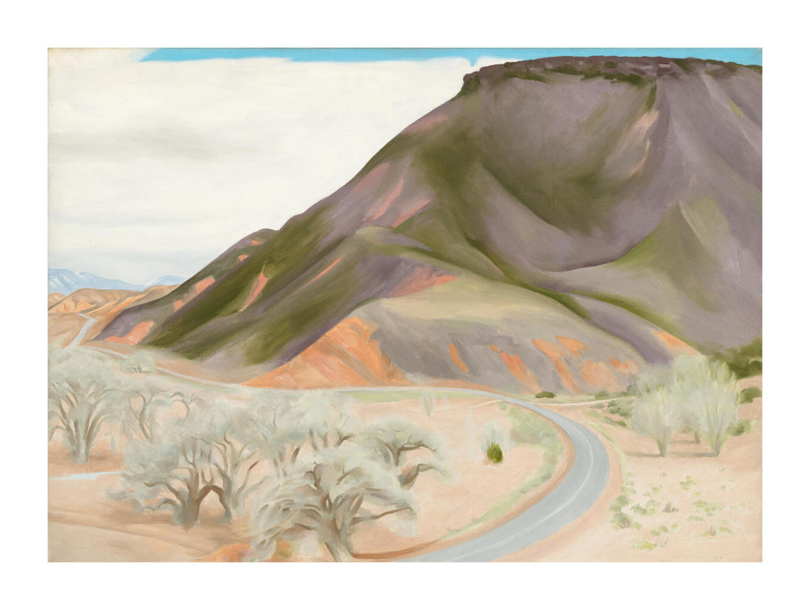

[[se-dinsta-2611]]
[[pub-nug-moc-261111]]
[[nug-xe-dinsta-ph-261123]]

### Awkwardness in Composition and Honesty

I would like to stay on this idea of "out of balance" verse " awkwardness that feels honest

> There has been a tradition of labeling awkwardness as real; that we must rebel against the polished and the slick. The line quality of Van Gogh for example often described as honest and awkward in the same breadth. Is "out of balance" interesting? Isn't there a thing as too balanced in a composition? Does balance require tension? In this O'Keefe painting do we want more of that blue sky? Is that "balanced" by the lightness of the touch in the painting of the road and trees. 

[[is-boex-thgo-alle-2611]] 