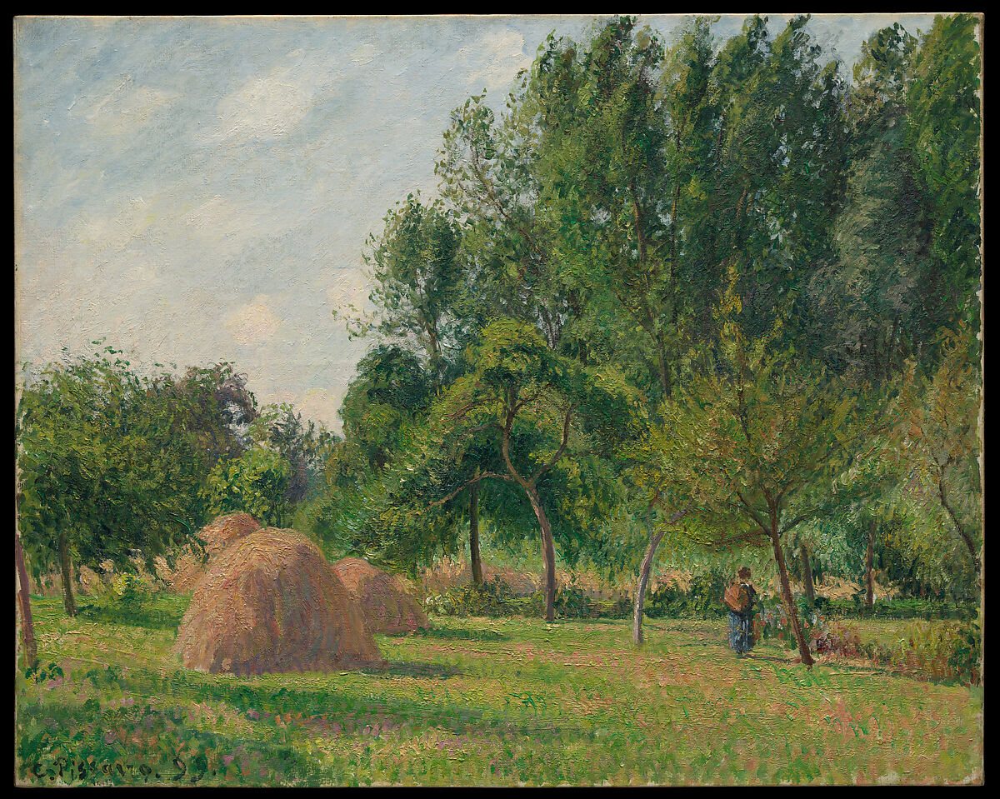

[pub-nug-moc-261111]

### Pissarro and Cezanne 
(Description of a Painting)

It is hard to know if these are wind shook trees or if the barrage of paint flecks have shaken them. I can ski upside down away from myself coursing that left corner funnel  of cloud sky towards the back of the painting. I am looking at a digital version of the painting and I remember that in person these Pissarro paintings are more of a mess than expected. The painting feels like a real possibility in time. I can imagine a painter spending a day or several recording this real place.

I can't help but think about Pissarro's relationship with Cezanne and how Pissarro gets leaned towards the quotidian and Cezanne towards the radical as the "Father of Modern Art." 

There is an earthy harmony about the picture.  The composition is not clever or pretentious and might feel very empty if not for the small figure on the right side. The terrain all appears changed by labor. Even the large trees seem more a wind block than a wild stand. Somehow this makes the rectangular frame of a picture make sense. 
