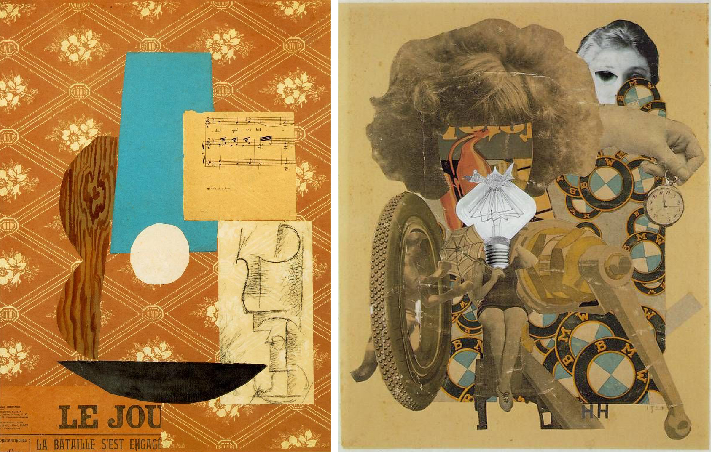

[[pub-nug-moc-261111]]
[[is-jubl-pope-261118.md]]

### Homogenization and Art as Machine
Quotes from the article: 

> "In an age of search engines, he said, 'the great danger is no longer just censorship, but homogenization; not merely imposed silence, but the noise that makes listening impossible."
---
How can my projects function to foster possible listening and communication with outselves but also with peers.

----

> "He insisted on the “ontological difference—prior even to the aesthetic—between art and what a machine can generate through statistical calculation based on millions of images created by others.”"
---
Art has been talking about this idea of the mechanization of man for over 100 years now. 
For example in the collage workshop I discuss these images: 

[[is-jubl-pope-261118.md]]
---

