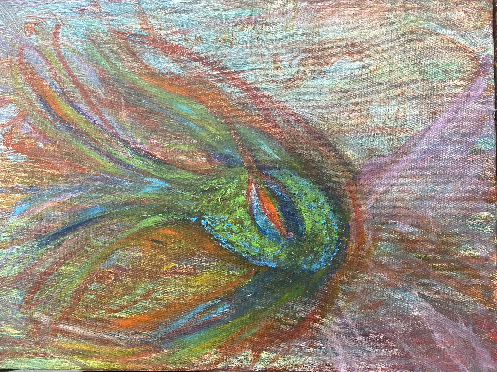
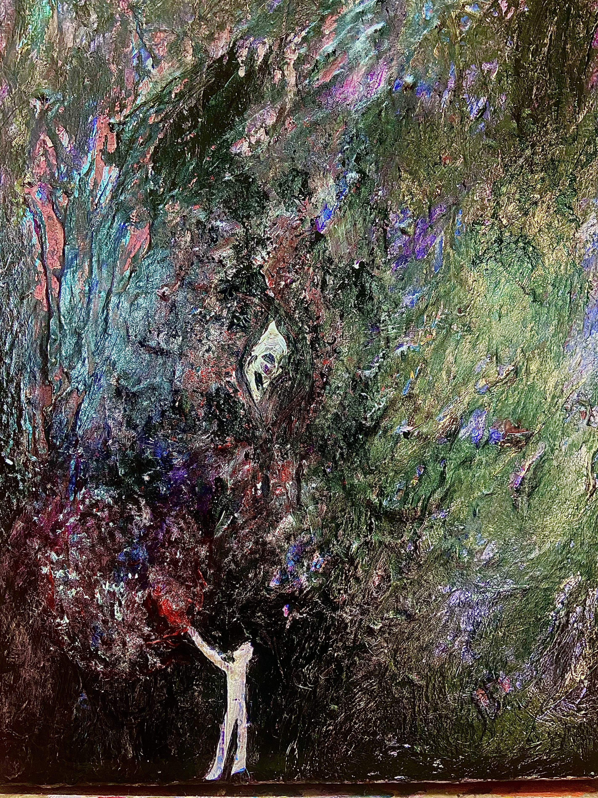
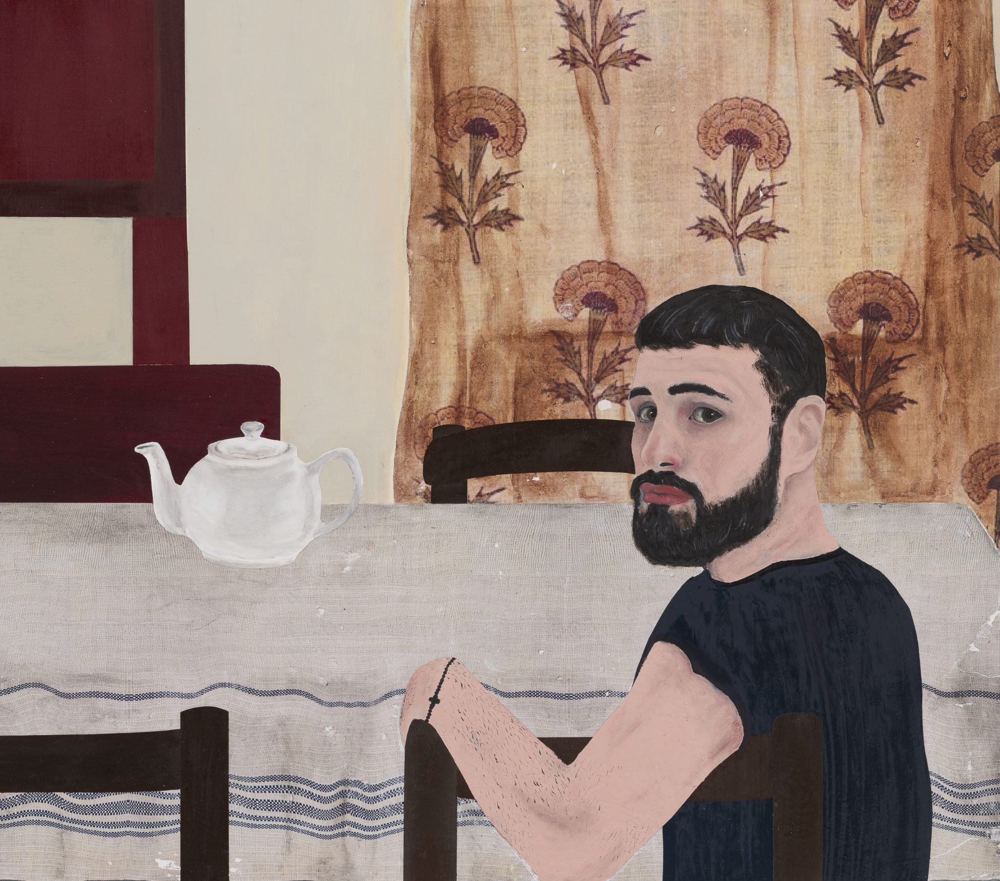

[[pub-nug-moc-261111]]

  

The history of painting is built with this idea. The [[Egyptian paintings]] are locked in tombs. They were not for public viewing. There are theories they were for the dead to witness. Who are paintings for? This is a profound and amazing question. There is a beautiful art work from meso-american history that was found buried. There are theories that it was periodically unburied to witness. 

This makes me think of a rhythm of lost and found emotions, of the inability for a human to take all this in. There are structures for shelving and accessing the vaults of our collective history and emotions. I often think of poetry and painting like this. As containers and packages of information that can unfurl with attention if willing to be vulnerable with the unknown. 

