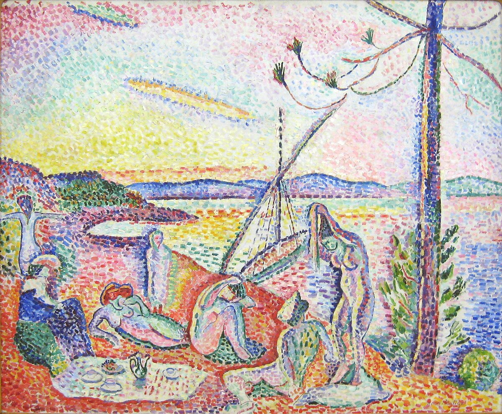
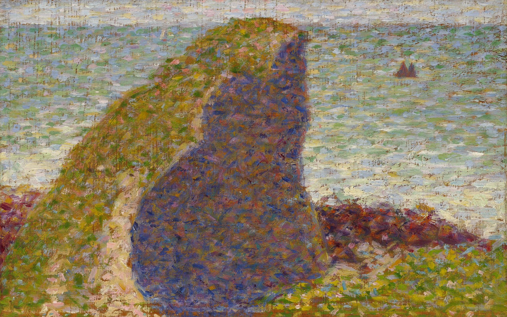

---
student:
  - pasa
  - "[[s-pasa-261118]]"
category: nugget
source emailxchange: "[[se-patricia-saulsbury-reply-11-02-26]]"
date: 2026-11-22
xchange nugget topic: ah = art history
holding bin moc: "[[pub-nug-moc-261111]]"
related project: divisionism
---

[[pub-nug-moc-261111]]

### Divisionism

> When referring to neo-impressionism, some modern art historians use the term *divisionism* to encapsulate this moment when the paint mark obliterated into tiny moments of recording impressions. The term *divisionism* really helped me to think about how a painting, and by extension any art work,  is made up of an accrual of moments. Fauvism, which rode on this wave of allowing the mark to unearth from its referent and splinter, can be seen as a carrier of this concept. 

> Often fauvism is capitulated as about color, which makes obvious sense; the brightness and  apparent arbitrary nature of the colors was disarming for its time period. But the fauvist paintings also carried on from neo-impressionism this radicality of loose separated marks that dance across the surface of the painting. 

> 