November 2026

A collection of summarized conversations acting as a mushroom collective think tank of this communities conversations and thoughts about art making:

email-clipped-nuggets:

1. [[nug-xe-cowr-ap-261111]] Realism and Obfuscation
2. [[nug-xe-dist-ap-261111]] Awkwardness and Honesty in Composition
3. [[nug-xe-dinsta-ph-261123]] Part 2
4. [[nug-xe-pasa-ah-261118-1]] Divisionism,  Caricature  and Hyperbole
5. [[nug-xe-elwe-p-261109]] Style and Process
6. [[nug-xe-casa-p-ah-261105]] Anthropomorphizing Objects and Narrative in Compositions
7. [[nug-xe-jubl-ph-2611]] Homogenization and Art as Machine
8. [[nug-xe-jubl-ah-p-261109]] Pissarro (Description of a Painting)
9. [[nug-xe-meul-ah-p-261101]] Paintings for the Dead
10. [[nug-uc-anoj-fu-261118]]  Landscape Motif and Scale of Brush Mark (Fundamentals)
11. [[nug-uc-cowr-p-261118]] Artists who use words and artists who don't
12. [[nug-uc-mame-fu-2611]] Details: Loose and Bold Paint Style (Fundamentals)
13. [[nug-xc-ws-gr-261119]] Definition of a Finished Painting (Single Painting Prompt)

email-clipped-doc-sources from students:

[[is-jubl-pope-261118.md]]
[[is-boex-thgo-alle-2611]]

email-clipped-images:

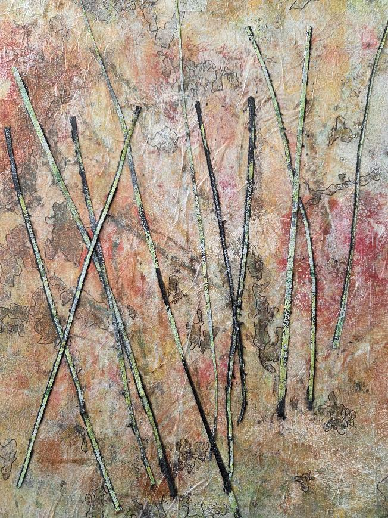 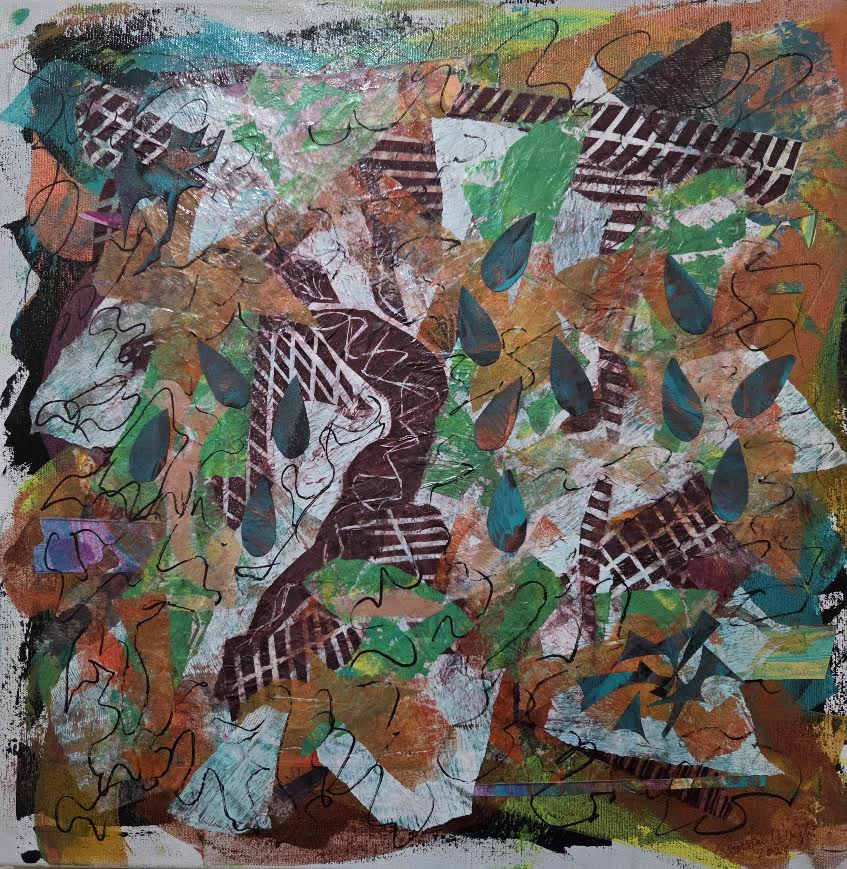 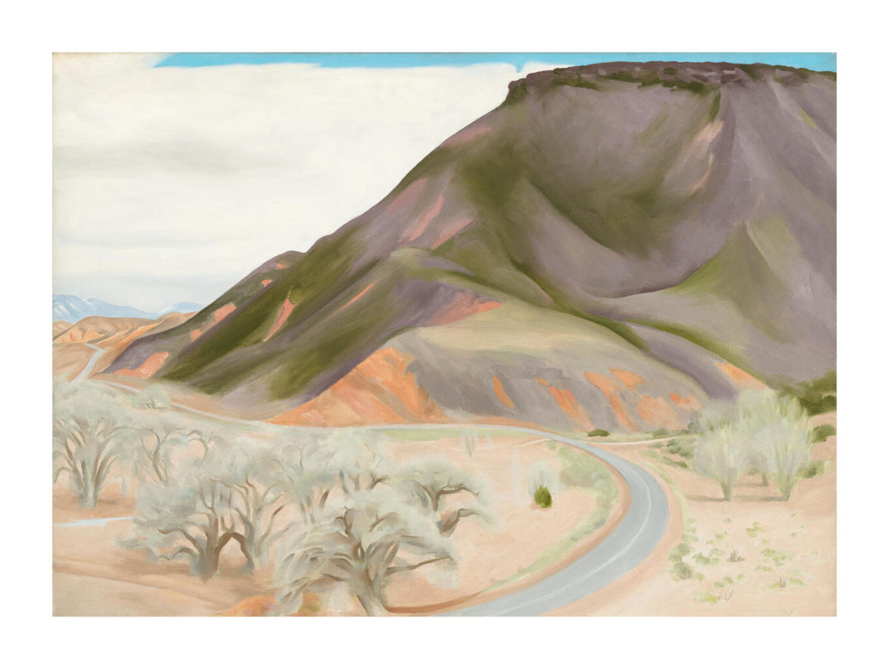
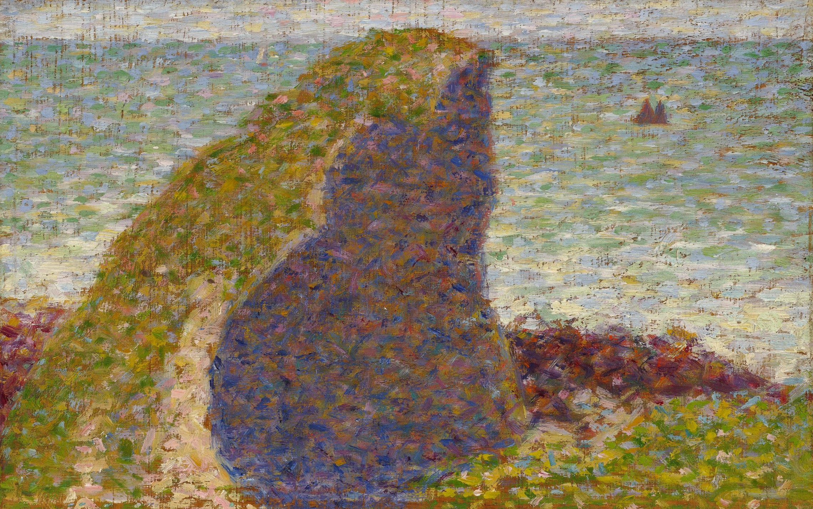 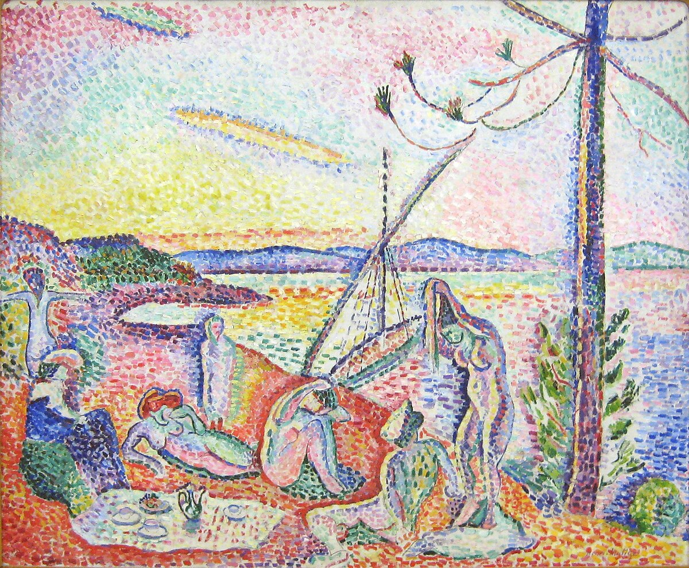 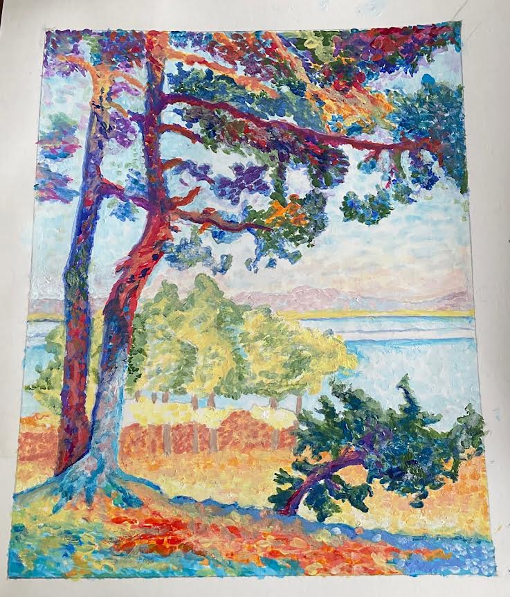 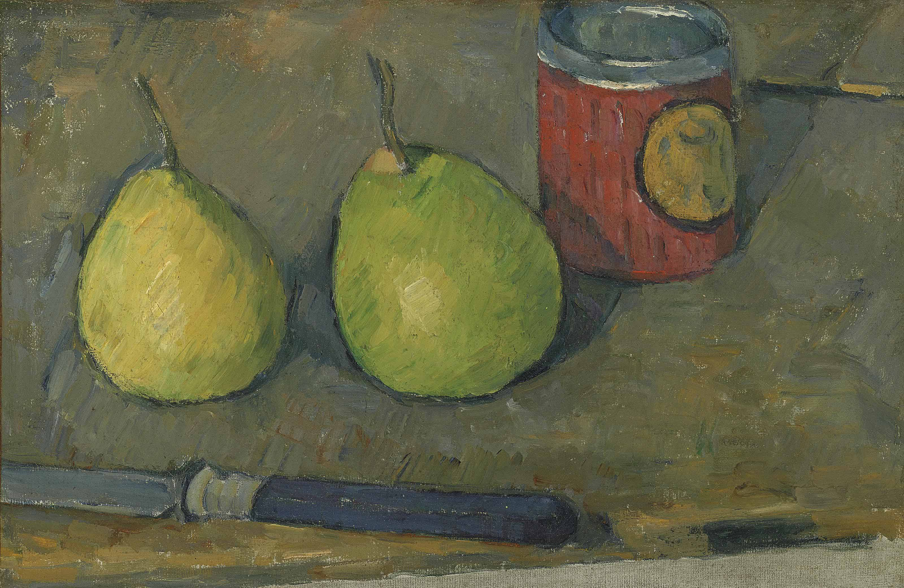
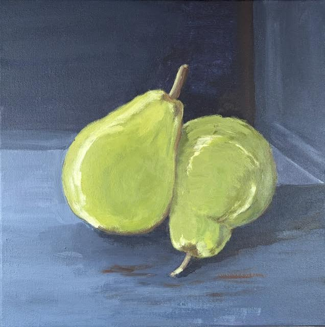 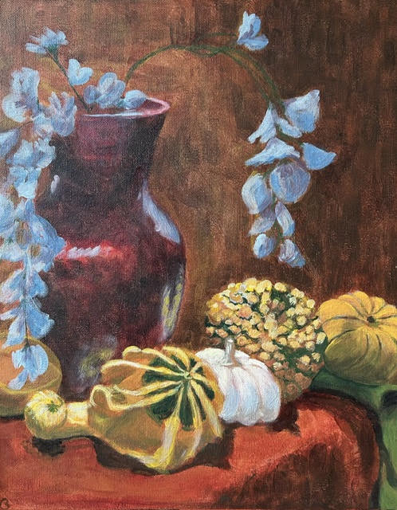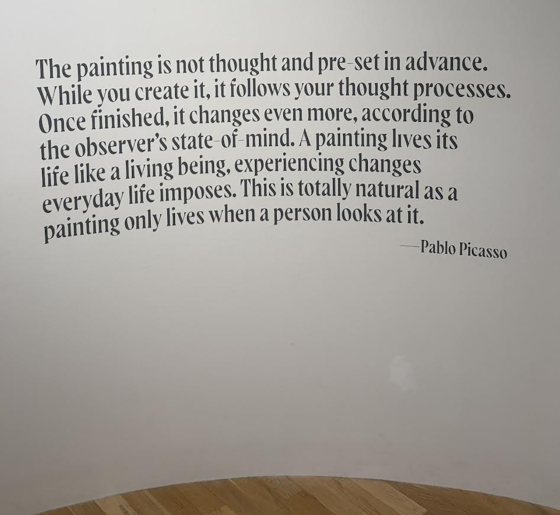 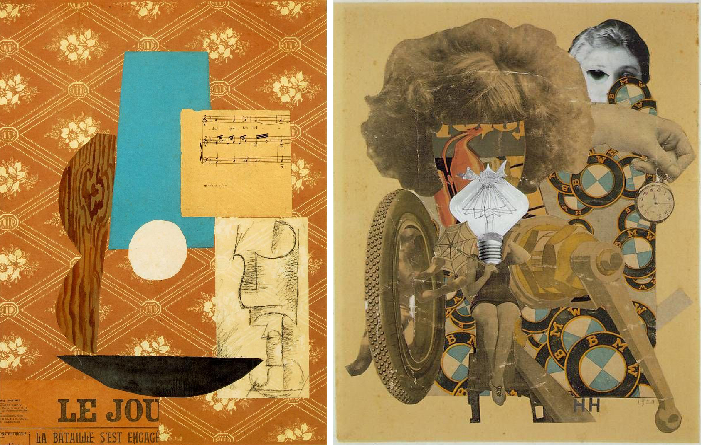 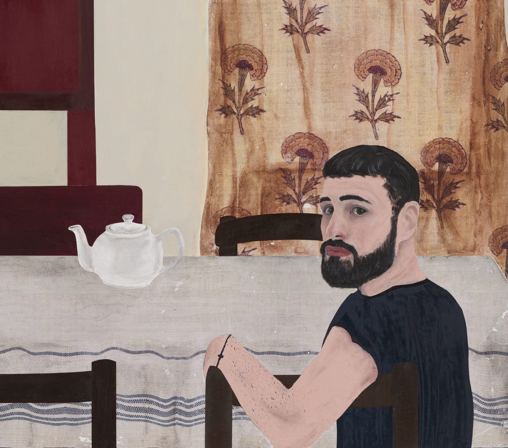 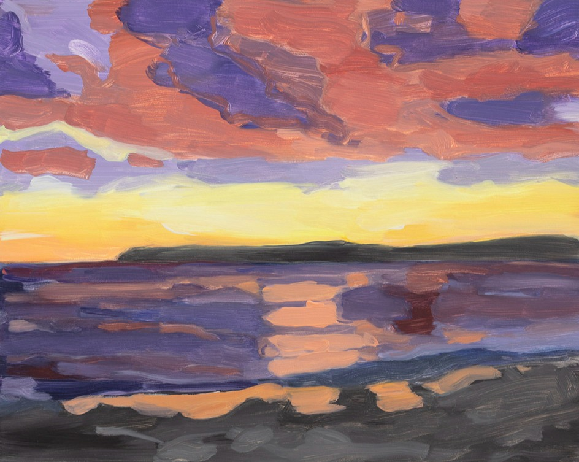 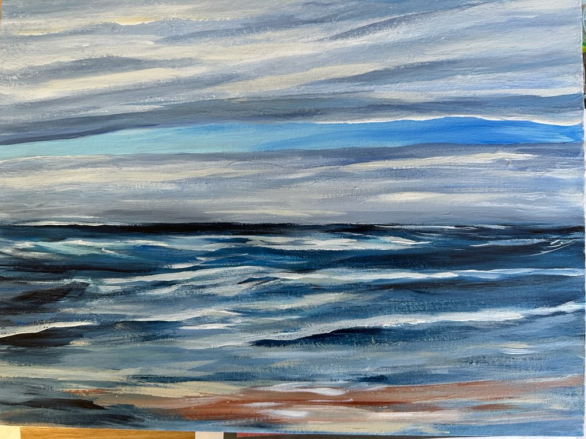

